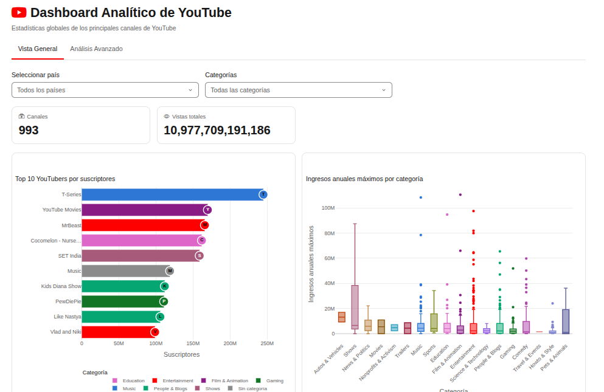
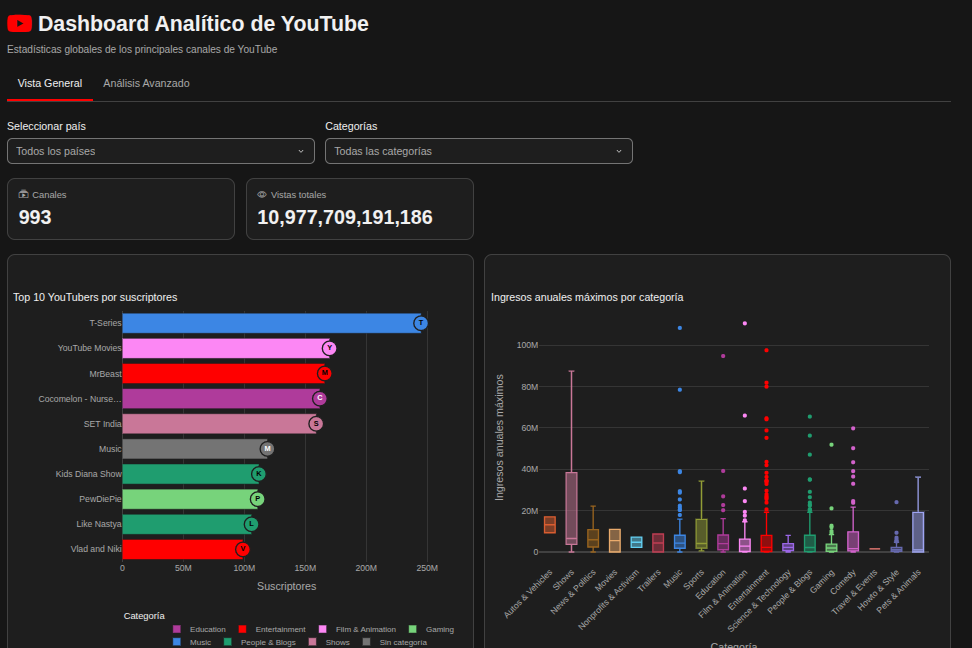
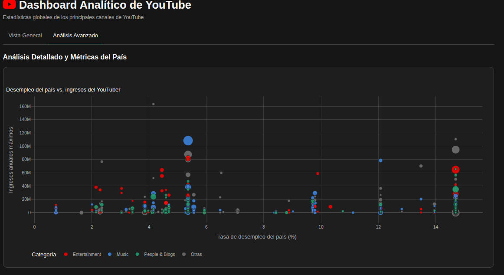
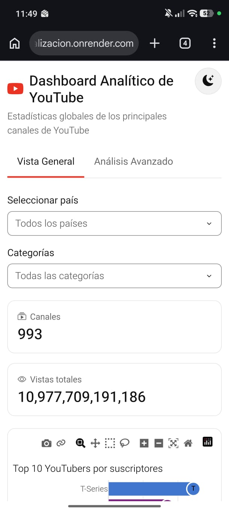
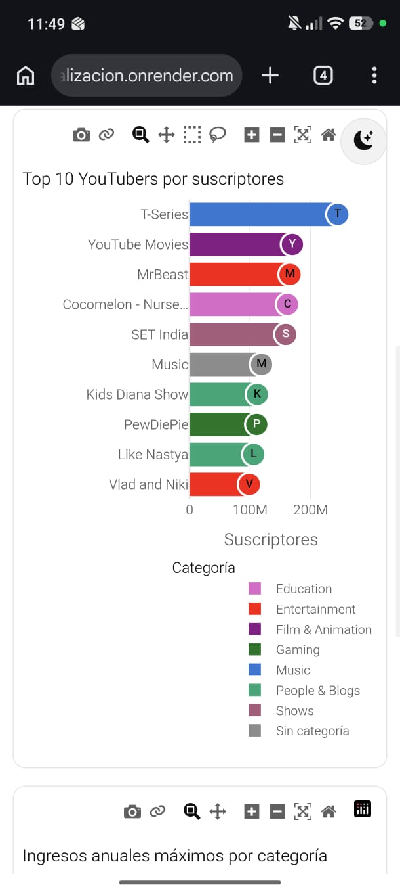
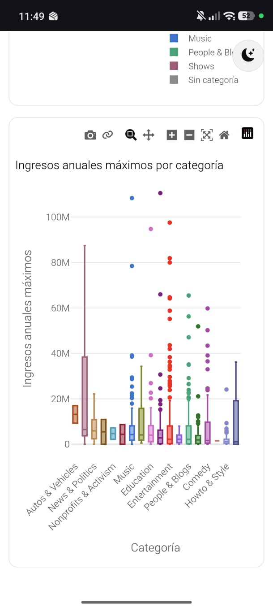

# Dashboard Analítico de YouTube

Dashboard interactivo construido con **Dash**, **Plotly** y **Dash Bootstrap Components** para explorar las estadísticas globales de los canales de YouTube con más suscriptores.

> Trabajo Práctico 2 · Visualización de Datos con Python

## Autores

- `[COMPLETAR: Nombre Apellido]`
- `[COMPLETAR: Nombre Apellido]`

## Descripción

El dashboard permite comparar los canales de YouTube con más suscriptores según su país y su categoría, y relacionar sus ingresos con indicadores económicos del país de origen.

**Pregunta de investigación** `[REVISAR: propuesta inferida a partir de los gráficos del dashboard]`:

> ¿Cómo se distribuyen la audiencia y los ingresos de los canales de YouTube más grandes según su país y su categoría, y existe relación entre la tasa de desempleo del país de origen y los ingresos estimados del canal?

La **Vista General** responde la primera parte (quiénes concentran más suscriptores y qué categorías tienen mayores ingresos, con filtros por país y categoría). La pestaña **Análisis Avanzado** aborda la segunda con un gráfico de dispersión entre desempleo e ingresos.

## Dataset

- **Fuente:** Kaggle, "Global YouTube Statistics" `[COMPLETAR: enlace al dataset en Kaggle]`
- **Archivo:** `data/Global_YouTube_Statistics.csv` (codificación latin-1)
- **Tamaño original:** 995 filas y 28 columnas
- **Tamaño después de la limpieza:** 993 filas y 26 columnas

**Variables principales**

| Variable | Descripción |
|---|---|
| `Youtuber` | Nombre del canal |
| `subscribers` | Cantidad de suscriptores |
| `video views` | Vistas totales de los videos |
| `category` | Categoría del canal (18 categorías; 46 canales sin categoría) |
| `Country` | País del canal |
| `lowest_yearly_earnings` / `highest_yearly_earnings` | Ingresos anuales estimados (mínimo y máximo) |
| `Unemployment rate` | Tasa de desempleo del país (%) |
| `Population`, `Urban_population`, `Gross tertiary education enrollment (%)` | Otros indicadores del país |

**Limpieza realizada** (`data/data_processing.py`):

1. Se eliminan las columnas `Latitude` y `Longitude` (de 28 a 26 columnas).
2. Se corrigen 92 nombres de canales con caracteres corruptos por la codificación. Los que no se pudieron identificar se marcan como `Nombre Local`.
3. Se eliminan las filas marcadas como `Nombre Local` que además no tienen país (2 filas; de 995 a 993).
4. Se asigna manualmente el país a 119 canales que no lo tenían en el CSV.
5. El canal `Desi Music Factory` queda sin país, porque ningún dato del CSV lo indica: no aparece en el filtro de países, pero sí se cuenta en los totales.

Además, la ruta del CSV se calcula relativa al archivo (`Path(__file__).parent`), así que la app funciona sin importar desde qué carpeta se ejecute.

## Estructura del proyecto

```
exploracion_visualizacion/
├── app.py                  # App Dash: encabezado, pestañas, botón de tema y callbacks del tema
├── theme.py                # Paleta, plantillas de Plotly (yt_light / yt_dark) y figura de estado vacío
├── requirements.txt        # Dependencias con versiones fijas
├── .python-version         # Versión de Python para el despliegue
├── README.md
├── data/
│   ├── Global_YouTube_Statistics.csv
│   └── data_processing.py  # Carga y limpieza del dataset
├── layouts/
│   ├── home.py             # Vista General: filtros, KPIs y dos gráficos
│   └── detail.py           # Análisis Avanzado: gráfico de dispersión
├── callbacks/
│   ├── filtros.py          # Filtros -> KPIs y gráficos de la Vista General
│   └── detalle.py          # Gráfico de dispersión según el tema
└── assets/
    ├── style.css           # Variables de color (claro/oscuro) y estilos de la interfaz
    └── theme.js            # Aplica el tema al cargar y funciones de los callbacks del lado del cliente
```

## Instalación local

Requiere Python 3.12 o superior (el proyecto usa 3.14, ver `.python-version`).

```bash
python -m venv venv
source venv/bin/activate        # En Windows: venv\Scripts\activate
pip install -r requirements.txt
python app.py
```

La app queda disponible en http://127.0.0.1:8050/

## Despliegue

- **URL:** https://exploracion-visualizacion.onrender.com/
- **Plataforma:** Render
- **Comando de inicio:** `gunicorn app:server`
- **Versión de Python:** definida en `.python-version`

## Funcionalidades

**Filtros** (Vista General):

- **País:** selección única (`filtro-pais`).
- **Categorías:** selección múltiple (`filtro-categoria`).
- Sin selección se muestran todos los canales. Los filtros se combinan entre sí y conservan su valor al cambiar de pestaña.

**Indicadores (KPIs):** cantidad de canales y vistas totales según los filtros.

**Gráficos:**

| Gráfico | Tipo | Pestaña |
|---|---|---|
| Top 10 YouTubers por suscriptores | Barras horizontales | Vista General |
| Ingresos anuales máximos por categoría (ordenados por mediana) | Boxplot | Vista General |
| Desempleo del país vs. ingresos del YouTuber (tamaño = suscriptores) | Dispersión de burbujas | Análisis Avanzado |

**Colores por categoría:** cada una de las 18 categorías tiene un color fijo, el mismo en los tres gráficos (definido en `theme.py`). En el top 10, cada barra lleva al final un círculo con la inicial del canal; la leyenda muestra solo las categorías presentes y los canales sin categoría aparecen en gris como "Sin categoría".

En el gráfico de dispersión se destacan las 3 categorías con más canales y el resto se agrupa como "Otras". Los canales sin tasa de desempleo no se muestran.

Si una combinación de filtros no tiene datos, los gráficos muestran un mensaje en lugar de quedar vacíos.

**Callbacks:**

| Callback | Entradas | Salidas |
|---|---|---|
| `renderizar_pestana` (`app.py`) | `tabs-navegacion.active_tab` | `contenido-tab.children` |
| `actualizar_dashboard` (`callbacks/filtros.py`) | `filtro-pais.value`, `filtro-categoria.value`, `theme-store.data` | `kpi-total-canales.children`, `kpi-total-vistas.children`, `grafico-top-subscribers.figure`, `grafico-categoria-ingresos.figure` |
| `actualizar_scatter` (`callbacks/detalle.py`) | `theme-store.data` | `grafico-scatter-detalle.figure` |
| `tema.alternar` (cliente, `assets/theme.js`) | `theme-toggle.n_clicks` (estado: `theme-store.data`) | `theme-store.data` |
| `tema.aplicar` (cliente, `assets/theme.js`) | `theme-store.data` | `theme-toggle-texto.children`, `theme-toggle.title` |

**Modo claro / oscuro:** el botón de la esquina superior derecha alterna el tema. La primera vez se usa la preferencia del sistema operativo y luego se recuerda la elección en el navegador. La interfaz y los gráficos cambian de colores. Los colores de las categorías tienen contraste suficiente con el fondo en cada modo y se distinguen entre sí con visión normal; para daltonismo (protanopía y deuteranopía) se verificó que se distingan las categorías vecinas, pero con 18 colores no todos los pares son distinguibles, por eso los nombres siempre están en ejes, leyenda y tooltips.

**Diseño responsivo:** con Dash Bootstrap Components (`Container`, `Row`, `Col`, `Card`). En celulares los filtros, KPIs y gráficos se apilan en una columna.

## Capturas de pantalla

**Vista General en modo claro:** filtros, KPIs, top 10 con avatares y boxplot por categoría.



**Vista General en modo oscuro:** los mismos gráficos con la paleta del modo oscuro.



**Análisis Avanzado (modo oscuro):** dispersión entre desempleo del país e ingresos, con las 3 categorías principales y "Otras".



**En celular (modo claro):** encabezado y filtros, top 10 con su leyenda, y boxplot.

<p>
  
  
  
</p>

## Tecnologías

| Paquete | Versión |
|---|---|
| Python | 3.14 |
| dash | 4.5.0 |
| dash-bootstrap-components | 2.0.4 (Bootstrap 5.3) |
| plotly | 7.1.0 |
| pandas | 3.1.0 |
| numpy | 2.5.4 |
| gunicorn | 26.2.0 |

## Conclusiones

`[COMPLETAR: conclusiones del análisis]`
